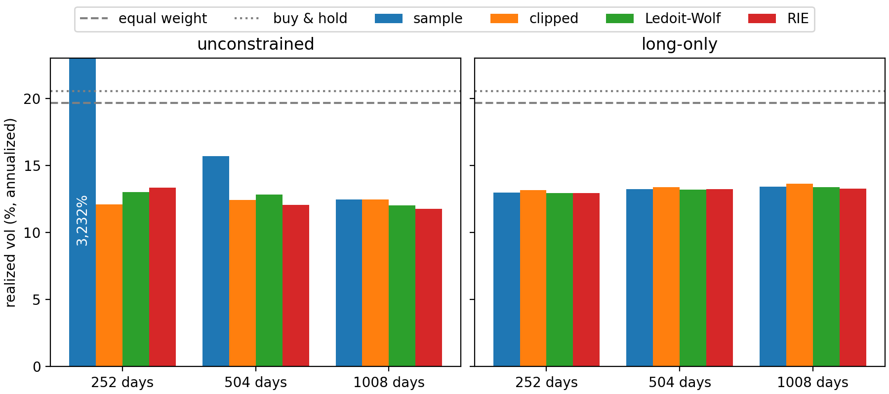
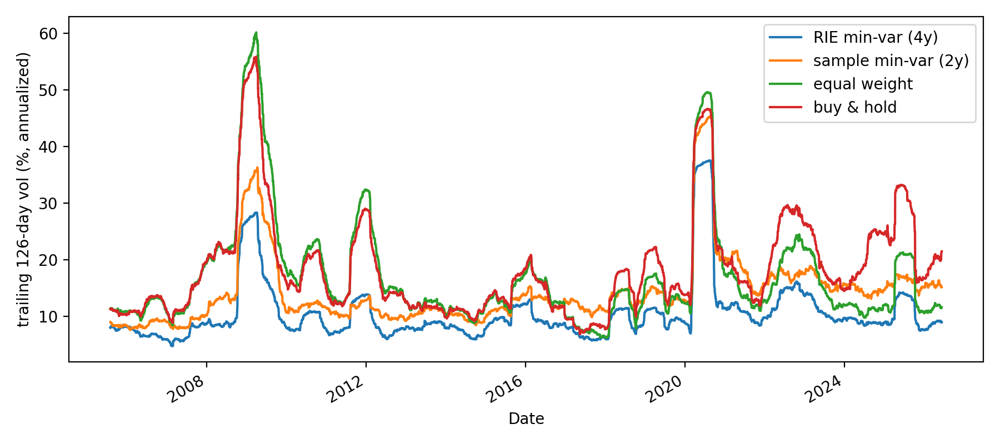

# RMT Portfolio Optimization
Minimum-variance portfolio construction requires the 
computation of the inverse of an N×N covariance matrix,
which is derived from T days of return data.

When the ratio q = N/T is not sufficiently small, the 
majority of sample eigenvalues can be considered as noise,
as described by the Marchenko-Pastur theorem. 

Consequently, the optimization process tends to allocate
significant weight to the noisiest and most underestimated 
dimensions, leading to a scenario where confidence is
highest precisely where the covariance estimates are least reliable.

This study aims to evaluate different covariance cleaning
techniques from random matrix theory and shrinkage methodologies
through a walk-forward minimum-variance backtest conducted on 
the 300 most liquid stocks within the S&P 500 index, spanning the years 2005 to 2026.

## Method

The universe is the 300 S&P 500 stocks with the highest average dollar volume over 2001–2004, among those with near-complete price history from 2001 onward. Ranking on the period before the backtest avoids look-ahead in the selection.

Portfolios rebalance on the first trading day of each month from February 2005. At each rebalance, the covariance is estimated from the previous T = 252, 504 or 1008 trading days, giving q = N/T ≈ 1.2, 0.6 and 0.3. Weights are then held without trading until the next rebalance. Each estimator is run unconstrained (closed-form minimum variance) and long-only (SLSQP).

Estimators: sample covariance; eigenvalue clipping (Laloux et al. 1999) ; Ledoit-Wolf shrinkage; and the rotationally invariant estimator (Bun et al. 2017).
## Results



*Realized out-of-sample volatility by estimator, estimation window, and constraint set, 2005–2026.*



*Trailing 126-day realized volatility for the best cleaned configuration, the sample covariance in the noisy q ≈ 0.6 regime, and the benchmarks.*
<!-- table:start -->
| strategy | window | ann. vol | Sharpe | mean monthly turnover |
|---|---|---|---|---|
| sample min-var | 504d | 15.7% | 0.33 | 2.08 |
| clipped min-var | 504d | 12.4% | 0.62 | 0.46 |
| Ledoit-Wolf min-var | 504d | 12.8% | 0.48 | 1.04 |
| RIE min-var | 504d | 12.0% | 0.66 | 0.26 |
| RIE min-var | 1008d | **11.7%** | 0.73 | **0.18** |
| equal weight (1/N) | — | 19.5% | 0.68 | 0.02 |
| buy & hold (index proxy) | — | 20.5% | 0.73 | — |
<!-- table:end -->

Rows are the unconstrained (shorting allowed) portfolios. Sharpe is excess of the 13-week T-bill rate.
Turnover is one-way, ½·Σ|w_new − w_drifted| per monthly rebalance, as a fraction of portfolio value (4.1 = 410%).

## Limitations
Primarily these results are limited by the survivorship bias inherent to the stock universe, which uses today's S&P 500 constituents back to 2005.
Without point-in-time index membership, and price data for companies that have been dropped from the index, the current universe is an approximation.
This means absolute results, especially Sharpe, are likely overstated, and the estimators are best compared against one another.
The strategies also do not take into account transaction costs, which would widen RIE's advantage over the other estimators due to its lower turnover.

## Reproduce

Requires Python ≥ 3.14 and [uv](https://docs.astral.sh/uv/). A Nix dev shell is also provided (`nix develop`).

```sh
uv sync
uv run python rmt/data.py              # download prices from yfinance into data/
uv run python scripts/run_backtest.py  # walk-forward backtest -> data/backtest_*.csv
uv run python scripts/plot_backtest.py # figs/backtest_vol.png, figs/rolling_vol.png
uv run python scripts/plot_spectrum.py # figs/spectrum.png
uv run python scripts/make_table.py # table in README.md
```
Numbers may shift slightly due to yfinance revising adjusted close prices.
